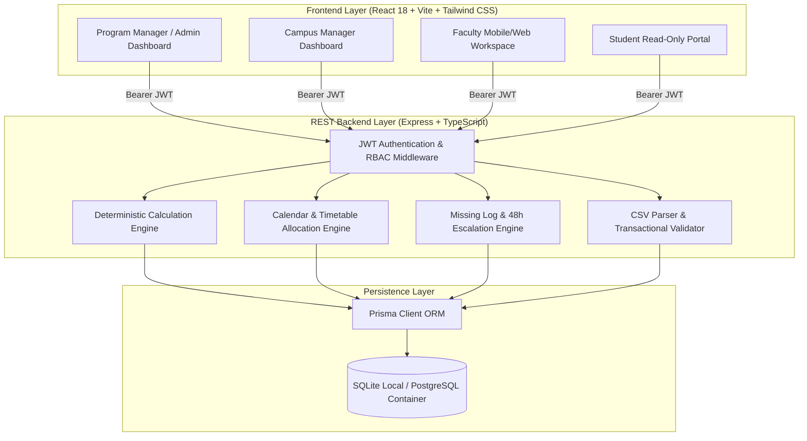
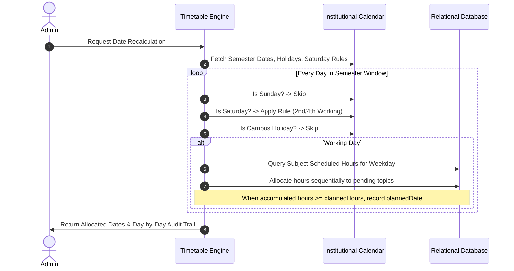
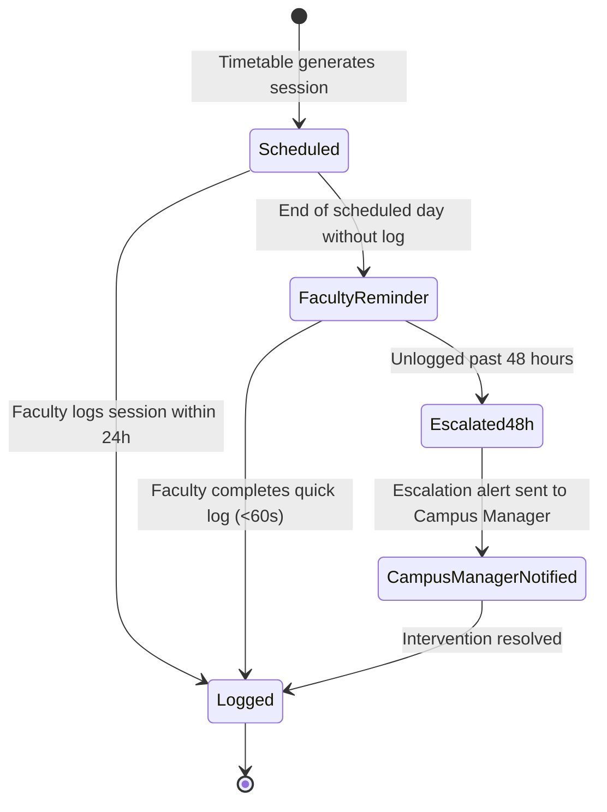
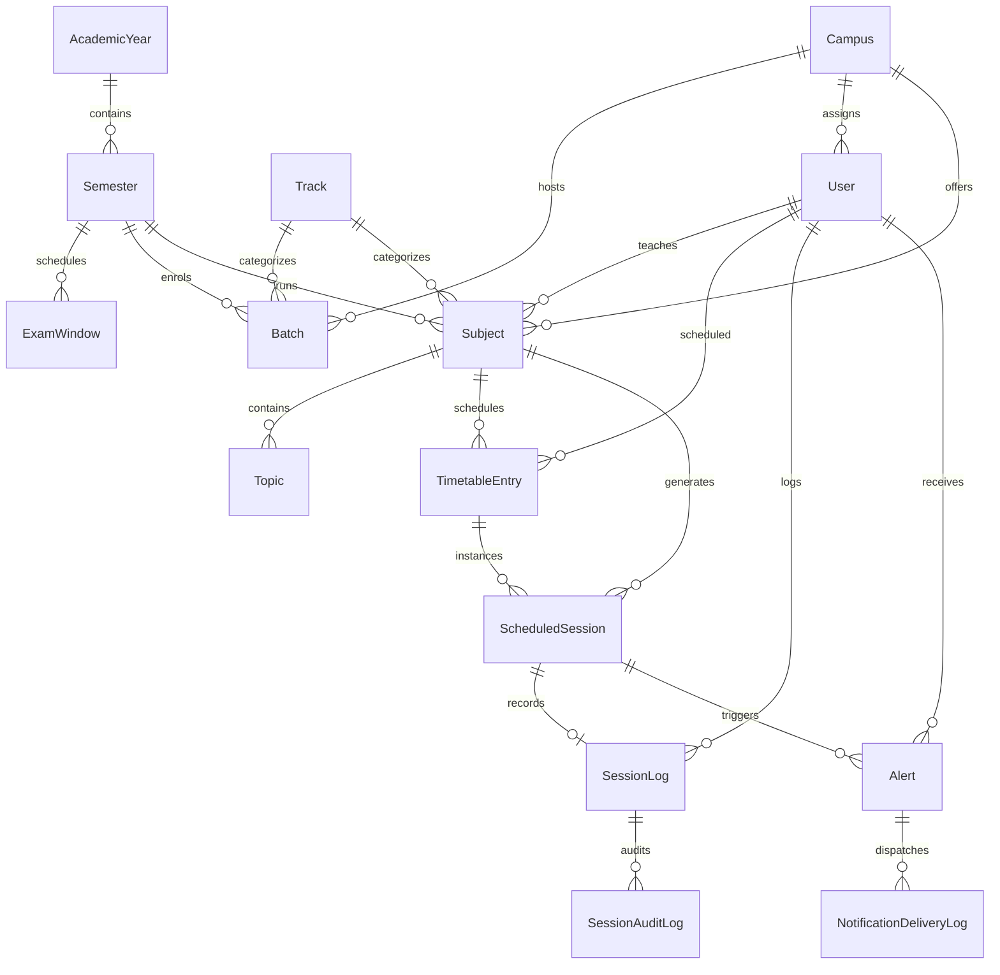

# Architecture & System Design Document
## Course Progression Tracker — Mirai School of Technology (MSOT)
### BTech CSE (AI/ML)

---

## 1. Executive Overview

The **Course Progression Tracker** replaces manual, brittle syllabus spreadsheets across Mirai School of Technology campuses (**HI-Tech, Ratnam, RGIB, and JUJ**) with a deterministic, real-time academic progression engine. It tracks planned teaching hours against timetable schedules, holidays, and classroom session logs to provide actionable early warnings before examinations.

---

## 2. High-Level Architecture

---

## 3. Core Calculation Definitions

All syllabus tracking in the system is weighted strictly by **planned teaching hours**, never by simple topic count. All calculations maintain internal floating precision and display to **two decimal places** (`.toFixed(2)`).

$$\text{Hours In Scope} = \sum_{\text{topic} \in \text{non-skipped}} \text{topic.plannedHours}$$

$$\text{Covered Hours} = \sum_{\text{completed}} \text{topic.plannedHours} + \sum_{\text{in-progress}} \left(\text{topic.plannedHours} \times \frac{\text{completion \%}}{100}\right)$$

$$\text{Coverage \%} = \frac{\text{Covered Hours}}{\text{Hours In Scope}} \times 100$$

$$\text{Remaining Hours} = \text{Hours In Scope} - \text{Covered Hours}$$

$$\text{Available Hours} = \sum_{\text{working days}}^{\text{target date}} \text{timetableScheduledHours}(\text{weekday})$$

$$\text{Buffer Ratio} = \frac{\text{Available Hours}}{\text{Remaining Hours}}$$

### Status Classification Thresholds:
- **`COMPLETE`**: Remaining Hours $\le 0.00$
- **`ON TRACK`**: Buffer Ratio $\ge 1.15$
- **`TIGHT`**: $1.00 \le \text{Buffer Ratio} < 1.15$
- **`DANGER`**: Buffer Ratio $< 1.00$

### Worst-Subject Roll-up:
Campus and Track roll-ups follow the **worst-case rule**, identifying the bottleneck subject driving that status rather than taking misleading averages.

---

## 4. Calendar & Timetable Allocation Workflow

---

## 5. Missing-Log Alert & Escalation Workflow

---

## 6. Entity Relationship Diagram (ERD)

